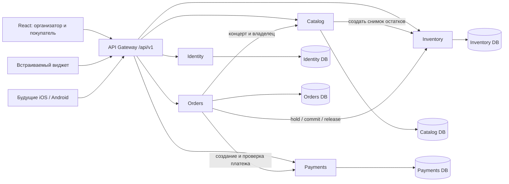
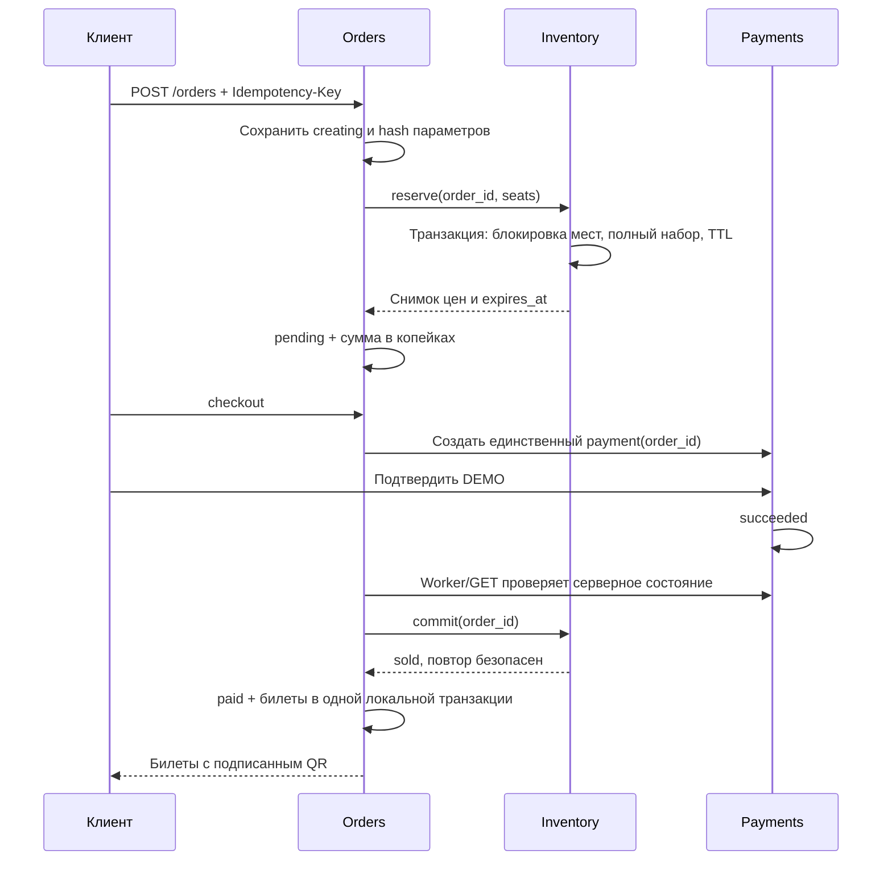

# Архитектура Ticketflow

## Границы и данные

Пять микросервисов имеют собственные процессы, модели, миграции и БД. Один Git-репозиторий не делает их одним сервером. В Docker — пять PostgreSQL 17; локально — пять независимых SQLite. Связь только через внутренний HTTP. Прямой доступ к чужим таблицам запрещён. Gateway не хранит бизнес-данные. Нет распределённой SQL-транзакции.

| Сервис | Владеет | Ответственность |
|---|---|---|
| Identity | users, sessions, attempts | Пароли, логин, роли buyer/organizer, ротация refresh, ограничение попыток входа |
| Catalog | halls, events, hall_templates, hall_sources, catalog_tasks | Владение схемой, revision, метаданные концерта, снимок публикации, slug |
| Inventory | event_stock, stock, holds | Цены в снимке, остатки, резервирование всего набора, TTL, продажа/освобождение |
| Orders | orders, tickets | Идемпотентный заказ, координатор saga, worker, выдача билетов, check-in, отчёт |
| Payments | payments | Уникальный платёж на заказ, демонстрационный адаптер, подтверждение/компенсация |

Общий пакет `services/common` содержит конфигурацию, инфраструктуру транзакций, проверку JWT и межсервисные контракты. При независимых релизах его нужно версионировать как пакет, а не синхронно обновлять все сервисы без проверки совместимости.

## Публикация

`draft → publishing → published`.

Catalog записывает `publishing` и полный снимок схемы **до** HTTP-вызова Inventory. Inventory создаёт остатки один раз, проверяя hash схемы и время окончания продаж. Повторный вызов с тем же снимком безопасен. После успешного ответа Catalog помечает концерт `published`; только тогда открывает виджет и принимает новые заказы.

Если ответ потерян, организатор нажимает повторную публикацию; используется сохранённый снимок. В первой версии автоматический worker публикации отсутствует. Публикация, застрявшая в `publishing`, видна организатору и может быть повторена. После публикации изменение условий запрещено: переносы/отмены с уведомлениями и аудитом требуют отдельного процесса.

## Заказ и оплата

Состояния Orders: `creating`, `pending`, `cancelling`, `paid`, `expired`, `cancelled`, `failed`, `refunded`. Терминальные состояния не меняются обычным GET. У Payments: `pending`, `succeeded`, `cancelled`, `refunded`. У Inventory: `available`, `held`, `sold`, `blocked` для мест; `held`, `sold`, `released` для брони.

`Idempotency-Key` уникален в рамках пользователя. Повтор с теми же параметрами возвращает тот же заказ. Другие места с тем же ключом → 409. Цена игнорируется как клиентская информация и запрещена в запросе: Inventory возвращает цены снимка, Orders вычисляет итог в целых копейках. На один заказ существует только один платёж.

Долговечный coordinator хранит намерение в Orders DB. Worker каждые три секунды выбирает до 100 ожидающих проверок, обновляя срок следующей проверки, чтобы старые брони не блокировали новые. GET заказа также выполняет восстановление. Сетевые вызовы имеют timeout. Worker можно запустить на нескольких инстансах: строка заказа блокируется, шаги других сервисов идемпотентны.

В первой версии локальная блокировка заказа удерживается во время межсервисного вызова. Это упрощает корректность, но при отказе зависимости увеличивает длительность транзакций. Следующий этап — lease координатора и асинхронные события через outbox/inbox; HTTP API при этом сохраняется. Обязателен мониторинг зависших состояний.

## Конкурентность и восстановление

В PostgreSQL Inventory получает `SELECT FOR UPDATE` на места в порядке seat ID. Конкурирующий запрос ждёт завершения транзакции, затем повторно видит состояние. Набор мест резервируется целиком или полностью откатывается. Проданные места не освобождаются по TTL. Повтор reserve блокирует одну запись hold, а уникальный hold ID устраняет двойное выполнение.

В SQLite локальный `BEGIN IMMEDIATE` сериализует записи. Он полезен для запуска без инфраструктуры, но не заменяет PostgreSQL-проверку конкурентности. Блокировки строк и стабильный порядок выбраны согласно [документации PostgreSQL](https://www.postgresql.org/docs/17/explicit-locking.html).

| Сбой | Что происходит |
|---|---|
| Потерян ответ reserve | Заказ остаётся creating; повтор того же hold ID возвращает созданную бронь |
| Worker остановлен | Истёкшее место доступно следующему reserve по expires_at; нет вечной блокировки |
| Получена оплата, commit недоступен | Заказ остаётся pending; worker повторяет шаг |
| commit прошёл, Orders упал до записи билетов | Повтор commit возвращает sold; билеты создаются в одной транзакции Orders |
| Оплата получена, но TTL закончился и commit невозможен | Демонстрационный платёж компенсируется, hold освобождается, заказ refunded, билеты не выдаются |
| Сбой после запроса отмены | Сохранённое cancelling повторяется worker до закрытия платежа и освобождения мест |
| Подтверждение оплаты одновременно с отменой | Payments сериализует операции на одной строке; оплата до close компенсируется, после close отклоняется |
| Изменение зала в другой вкладке | Старая revision отклоняется с 409; черновик клиента сохраняется |

Проверки покрывают ключевые сценарии, но не доказывают отсутствие всех ошибок. При настоящем эквайринге `refund_requested` и `refunded` должны быть разными состояниями; успешный вызов API возврата ещё не подтверждает фактический возврат средств.

## Безопасность

- Пароли — Argon2. Access JWT действует 15 минут; refresh 30 дней, хранится только hash. Для браузера refresh — HttpOnly cookie, SameSite=Lax, access — в памяти.
- Ротация refresh и logout отзывaют текущую refresh-сессию. Уже выпущенный access остаётся действителен до exp. Глобального отзыва всех устройств и reuse detection семейства пока нет.
- Buyer и Organizer имеют отдельные возможности. Проверяется владелец каждого зала, концерта, заказа, платежа и билета. Поиск чужого заказа/зала возвращает 404.
- Внутренний HTTP защищён отдельным секретом; nginx удаляет поступивший от браузера internal header. Docker-порты сервисов и БД не публикуются.
- В текущей учебной конфигурации JWT HS256 и один internal secret разделяются сервисами. Для публичного запуска заменить на асимметричные подписи/JWKS и идентификацию каждого сервиса (mTLS/короткие service tokens), чтобы Inventory/Payments не могли выпускать пользовательские токены.
- Включить TLS, Secure cookies, allowed origins, CSRF-защиту для cookie-auth изменений и лимиты на создание аккаунтов; добавлять OAuth только через state + PKCE и проверенный callback.
- QR имеет отдельные aud/iss, содержит только ticket ID/event ID. Строка билета блокируется перед check-in. QR bearer-код нельзя публиковать в логах.
- Произвольный iframe не получает права организатора. В стороннем iframe third-party cookies могут блокироваться: интерфейс предлагает открыть покупку в новой вкладке. Оплата внутри чужого iframe до отдельного безопасного handoff не гарантируется.
- Production-конфигурация отказывается принимать настройки с demo-платежами или незащищённой cookie. Реальный адаптер ещё должен быть реализован.

## Масштабирование

React статически раздаётся CDN; API за gateway масштабируются отдельно. Самая нагруженная операция — Inventory: индекс `(event_id, seat_id)`, короткая транзакция и стабильно отсортированные row locks. Новые сервисы не добавляются только ради количества. Для пиков продаж: лимит одновременных покупок, очередь ожидания, backpressure, connection pool и нагрузочные измерения.

Redis можно добавить для rate limits, кэша публичных метаданных и рассылки обновлений схемы. Он не должен стать единственным источником продажи места. Очередь с transactional outbox, дедупликацией inbox и retry/DLQ применяется для оплаты, отправки билетов и аналитики после добавления реальных интеграций. Redis и брокер **пока не реализованы**.

PostgreSQL хранит authoritative state. Данные разделяются по событиям/организациям после измерений; миграции выполняются до релиза. Нужны резервные копии, проверка восстановления, reconciliation отчёты эквайринга, трассировка, метрики, алерты и SLO. Наличие request ID и health — только начальная наблюдаемость.

## Мобильные приложения

Единая `/api/v1` и OpenAPI; интерфейс и инфраструктура не связаны с React-состоянием. Перед выпуском iOS/Android: генерация клиентов, mobile refresh/revoke contract, OAuth Authorization Code + PKCE с universal/app links, токены в Keychain/Keystore, push, provider checkout в защищённом браузере и загрузка билетов для offline просмотра. Сервер остаётся источником авторизации и доступности. Offline check-in требует отдельного протокола синхронизации и разрешения конфликтов; текущий check-in только online.

## Афиша и общая библиотека залов

Публичная афиша получает только опубликованные события и `min_price` из продаваемых категорий неизменяемого снимка; это цена категории, а не обещание текущей доступности. Наличие мест определяется Inventory в виджете. Интерфейс загружает концерты страницами по 100 и применяет фильтры к уже загруженным данным; следующую страницу можно загрузить кнопкой. При большом каталоге нужны серверные фасеты, поисковые индексы и сортировка по проекциям — без скачивания всего каталога клиентом.

Библиотека принадлежит Catalog. `hall_templates` — неизменяемые опубликованные схемы, сгруппированные по нормализованной площадке. Запись создаётся вместе с завершением публикации; сбой до commit сохраняет `publishing` и допускает повтор. Копирование создаёт `halls` с новым владельцем и `hall_sources` для связи с источником; полный снимок копируется, общих изменяемых ссылок на JSON нет. Backfill прежних публикаций и его маркер `catalog_tasks` фиксируются атомарно; следующие старты не пересканируют все концерты.

Геометрия Level/Shape поддерживается обоими сервисами Catalog и Inventory. Widget использует тот же SVG-рендеринг объектов, уровни переключаются отдельно от корзины. Выбранные места другого уровня сохраняются; билет содержит название яруса. Стабильный seat ID и составной ключ Inventory event_id/seat_id остаются единственной идентичностью продаваемого места.

Редактор использует общую палитру `editorShapes.ts` и единый `HallGeometry` для плана, библиотеки и покупательского виджета. Символы/ступени/стойки рисуются в SVG и обрезаются фактическим контуром. `HallObject.variant` — совместимое необязательное поле; геометрия и квоты от стиля не зависят. Неактивные этажи отображаются без интерактивности и без кнопок мест, с opacity 0.17; активный уровень рисуется поверх. Корзина хранит seat ID независимо от переключения уровня.

Палитра создания слева отделена от контекстного инспектора справа. Без выбора инспектор не содержит полей. Ручка дуги и живой ползунок меняют существующие координаты мест; один pointer gesture записывает один исходный снимок в undo. Свойства, свободные вершины, уровни, цены и пресеты остаются частью ревизии Layout, локального черновика и серверной валидации. Восемь готовых основ — учебные планы; не заявляются как точные схемы реальных площадок.
